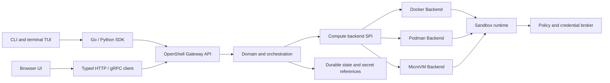

<!--
SPDX-FileCopyrightText: Copyright (c) 2026 quarshell
SPDX-License-Identifier: Apache-2.0
-->

# Architecture and module boundaries

The responsibility of every independent module is listed in
[Project modules](modules.md).

The accepted decision that governs these contracts is recorded in
[ADR 0001: Domain model and compute backend SPI](decisions/0001-domain-and-backend-spi.md).

Quarshell is the product name. Active Go module paths use the `quarshell-*`
namespace; the `quarshell` executable name is retained as a product command.



## Ownership and dependency direction

| Module | Owns | May depend on |
|---|---|---|
| `quarshell-core` | Domain values, policy, validation, typed errors, capability definitions | Standard library and small domain utilities |
| `quarshell-proto` | Pinned OpenShell protocol sources and generated Go, Connect, and TypeScript bindings | Schema tooling |
| `quarshell-driver` | Compute SPI and Docker, Podman, MicroVM implementations | Core, runtime asset contracts, engine clients |
| `quarshell-runtime` | Guest init, supervisor, SSH/PTY, guest protocol | Core and runtime assets |
| `quarshell-proxy` | Egress enforcement, credential mediation, audit | Core policy and runtime protocol |
| `quarshell-policy` | Provider profiles, credential declarations, refresh validation | Core policy |
| `quarshell-gateway` | API composition, auth, durable state, operation orchestration | Core, proto, driver, runtime, proxy, providers |
| `quarshell-sdk` and `quarshell-python` | Typed API clients and streaming helpers | Public API schemas |
| `quarshell-cli` | Commands, terminal presentation, shell completions | SDK and terminal libraries |
| `quarshell-ui` | Browser presentation and browser-safe client | Typed browser client and gateway API |
| `quarshell-cli`, `quarshell-core/slogx`, `quarshell-docs` | Display, logging utility, documentation | Their narrow public inputs |

The dependency flow is one way: API clients call the gateway; the gateway
selects and validates a backend; backend implementations use the runtime and
host engine. Gateway code does not import CLI or UI packages. The CLI may keep
its terminal TUI as a presentation package and use the SDK for operations. The
browser UI uses a typed API client and never launches the CLI or imports its
internal packages.

The browser console lives in the separate `quarshell-ui` module. It uses the
generated OpenShell Gateway client and does not launch or import the CLI. The CLI
ships commands and a terminal TUI; it does not ship a second HTTP browser app.

This boundary follows the public integration surfaces of current developer
tools. OpenShell v0.1.4 separates its CLI, SDK, server and compute driver
crates. Cursor documents its editor Agent and a CLI with interactive and
non-interactive modes; the CLI supports the editor's modes, while the docs do
not claim both clients share an internal API. OpenAI publishes Codex CLI, SDK
and app-server integrations: the SDK serves programmatic tasks, while
app-server exposes thread, turn, event and approval flows to an application
that owns its interface and workflow. This evidence supports keeping Quarshell
CLI and browser UI as separate clients of a shared public API. It does not
establish private implementation details for Cursor or Codex. See the
[Cursor Agent overview](https://cursor.com/docs/agent/overview),
[Cursor CLI overview](https://cursor.com/docs/cli/overview), and
[Codex app-server integration guidance](https://developers.openai.com/blog/codex-as-a-platform).

## Compute backend SPI

`quarshell-driver/driver/backend.go` introduces the product-owned `Backend` SPI.
Its request separates workspace, workload, resource limits, mounts, network,
runtime assets and backend-owned typed configuration. The base interface owns
create validation and lifecycle operations. Optional interfaces include
`InteractiveExec`, `LogAccess`, `FileTransfer`, `ServiceForward`,
`RootfsImporter`, `CredentialRotator`, `RuntimeTokenStarter`,
`RuntimePolicyUpdater`, `RuntimeLaunchSpecRestorer`,
`RuntimeCredentialRefresher`, `RuntimeContractValidator`,
`RuntimeProxyReadiness`, `RuntimeProcessWaiter`, `RuntimeProcessLogs` and
`RuntimeProcessTerminal`, and `RuntimeRootfsTarStager`.
`RequireExtension[T]` checks both the advertised
capability and the implemented method, returning `UnsupportedError` on either
mismatch. Orchestration can validate a create request before it writes durable
state or consumes a one-use upload.

All built-in implementations register the modular contract directly. The Gateway resolves only native `Backend` factories and remote OpenShell ComputeDriver protocol clients; it has no local `Engine` factory or fallback. Docker, Podman, Kubernetes and VM own their typed create inputs and optional extensions. The VM runtime still fails closed until its host supervisor and isolation lifecycle meet the Gateway contract.

New implementations can register the product contract directly. The Gateway resolves only the registered native `Backend` factory. A
registered factory error is returned directly. Each backend uses its own typed
startup config and optional extensions:

```go
func RegisterCustomVM() error {
    return driver.RegisterBackendWithConfig("custom-vm", func(raw map[string]any) (driver.Backend, error) {
        config, err := parseCustomVMConfig(raw)
        if err != nil {
            return nil, err
        }
        return customvm.NewBackend(config), nil
    })
}

type customVMBackend struct {
    config customvm.Config
}

func (b *customVMBackend) ID() driver.BackendID { return "custom-vm" }

func (b *customVMBackend) Capabilities(context.Context) (driver.BackendInfo, error) {
    return driver.BackendInfo{
        ID: b.ID(),
        Capabilities: map[driver.Capability]struct{}{
            driver.CapabilityInteractiveExec: {},
            driver.CapabilityFileTransfer: {},
        },
    }, nil
}

// Implement ValidateCreate, Create, Start, Stop, Delete, List and Inspect.
// Implement driver.InteractiveExec and driver.FileTransfer only when those
// capabilities have a real, tested implementation.
```

The factory key is the backend ID and its returned `Backend.ID()` must match
that key. Configuration is parsed once when the configured backend is first
selected. Gateway maps the pinned OpenShell request into the domain
`BackendCreateRequest` once at the protocol boundary; each backend then handles
that modular request directly. Product-owned extension interfaces cover
runtime validation, token-aware start, policy delivery, launch-spec restoration,
credential refresh and proxy readiness directly on the modular Backend.
`BackendInfo.Resources` can also report portable CPU, memory and GPU request
support. Built-in Backend registration includes a static `BackendInfo` snapshot,
so `GetGatewayInfo` reports local capabilities before a lazy Backend is created.
Extensions registered without static metadata are reported after their Backend
has already been initialized. `Capabilities` is static metadata and must not
initialize a runtime or perform network I/O.
Secret values in runtime or proxy inputs are short-lived request data and must
never be copied into durable create records.

The core OpenShell extension negotiation helper checks protocol major versions
and family-specific contract capabilities. Both peers must require and support
`openshell.<family>.contract`; unknown families and incomplete metadata are
rejected. RPC consumers still need to wire in this helper and prove that
advertised operations pass backend acceptance.

Gateway resolves only registered native SPI backends for create preflight,
create, start, stop, delete, create rollback, runtime reconciliation and
sandbox recreation. Remote compute plugins use the same Backend contract.
`RuntimeLaunchSpecRestorer` restores process-local workload settings after a
Gateway restart; `RuntimeCredentialRefresher` refreshes credentials through an
explicit Kubernetes capability; `RuntimeContractValidator` gates VM create on
its Gateway requirements. `RuntimeProxyReadiness` handles the VM and Kubernetes
proxy readiness check, while local containers use base `Backend.Inspect`.
Docker and Podman expose canonical process wait, logs and terminal attachment
through separate process extensions. Rootfs tar staging is dispatched through
`RuntimeRootfsTarStager` and `CapabilityRootfsTarStaging`. VM non-TTY exec uses the `InteractiveExec`
extension after checking the backend's declared capabilities. Restart uses the
optional `RuntimeTokenStarter` extension when the backend explicitly advertises
`CapabilityTokenAwareStart`; Kubernetes declares this capability, and the
adapter forwards only to its token-aware lifecycle method:

```go
starter, err := driver.RequireExtension[driver.RuntimeTokenStarter](
    ctx, backend, driver.CapabilityTokenAwareStart, "restart with a fresh token",
)
if err == nil {
    err = starter.StartWithToken(ctx, sandboxID, freshToken)
}

policyUpdater, err := driver.RequireExtension[driver.RuntimePolicyUpdater](
    ctx, backend, driver.CapabilityPolicyUpdate, "deliver a runtime policy update",
)
if err == nil {
    err = policyUpdater.UpdateSandboxPolicy(ctx, sandboxID, effectivePolicy)
}

credentialRefresher, err := driver.RequireExtension[driver.RuntimeCredentialRefresher](
    ctx, backend, driver.CapabilityCredentialRefresh, "refresh runtime credentials",
)
if err == nil {
    err = credentialRefresher.RefreshRuntimeCredentials(ctx, sandboxID)
}

platformWatch, err := driver.RequireExtension[driver.PlatformEventStream](
    ctx, backend, driver.CapabilityPlatformEvents, "watch platform events",
)
if err == nil {
    events, err := platformWatch.WatchPlatformEvents(ctx, driver.PlatformEventWatchRequest{
        SandboxID:   sandboxID,
        SandboxName: sandboxName,
    })
    if err == nil {
        for result := range events {
            if result.Err != nil {
                break
            }
            // Handle result.Event.
        }
    }
}
```

`PlatformEventStream` carries backend-native observations without claiming a
durable cursor. The remote ComputeDriver Backend converts the pinned watch RPC
into product-owned event values at the protocol boundary; protobuf types do
not enter the watch handler. Backends that can guarantee resumable
generation and sequence semantics should implement `EventStream` instead.
Docker and Podman adapt Engine container events to this stream, filtered by the
immutable container ID. These events have no durable cursor; Gateway's
persisted lifecycle observations remain a separate source.

Kubernetes declares `CapabilityTokenAwareStart`, `CapabilityPolicyUpdate`,
`CapabilityCredentialRefresh` and `CapabilityProxyReadiness`; VM declares
`CapabilityGatewayRuntimeValidation`, `CapabilityProxyReadiness` and
`CapabilityRootfsTarStaging`.
Docker and Podman declare process wait/log/terminal capabilities.
Gateway requires the policy capability before delivering an update to its
remote runtime; local container backends continue to use the shared policy
file. Runtime reconciliation, sandbox recreation and launch-spec restoration
use the base SPI and its declared extensions. Built-in backend dispatch is
modular; full parity remains open for VM host-supervisor/isolation acceptance
and removal of the unused flat driver API.

## Protocol compatibility boundary

The generated OpenShell Gateway server maps the pinned upstream protobuf
contract to Quarshell domain operations. Upstream package and service names remain intact
on that wire endpoint. Quarshell-owned domain types, configs, logs, CLI help and
new APIs use Quarshell names. Generated protocol packages, wire identifiers,
license attribution, pinned source and compatibility fixtures retain upstream
names where the contract requires them.

The comparison baseline is OpenShell v0.1.4 at commit
`5a7728c304b5528e954e9ae900cf21f84e1a12b1`. It contains 83 methods in the
public service and adds provider-label filtering, operator-only credential
export and stable-placeholder negotiation. A method being registered is not
proof of behavioral compatibility. See the
[compatibility register](../reference/openshell-compatibility.md) and
[runtime acceptance matrix](../reference/runtime-acceptance.md).

## Runtime path

1. The CLI or browser client sends a typed API request to the gateway.
2. The gateway authorizes the workspace, resolves policy and provider
   references, selects a backend, and validates supported fields.
3. The backend creates the sandbox and any required runtime resources.
4. The runtime reports readiness and policy state to the gateway.
5. Network requests pass through the policy enforcement path; credential
   material is released only when the runtime can enforce the matching
   endpoint binding.

Docker and Podman have broader lifecycle coverage than MicroVM. MicroVM
Gateway creation remains fail-closed until the host isolation, image import,
recovery and target-host acceptance gates pass. Kubernetes, browser UI feature
completion and other remaining features are tracked in the internal second
implementation plan.
