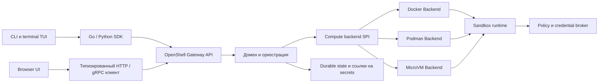

<!--
SPDX-FileCopyrightText: Copyright (c) 2026 quarshell
SPDX-License-Identifier: Apache-2.0
-->

# Архитектура и границы модулей

Назначение каждого независимого модуля перечислено в разделе
[Модули проекта](modules.md).

Принятое решение, задающее эти контракты, записано в
[ADR 0001: доменная модель и compute backend SPI](decisions/0001-domain-and-backend-spi.md).

Quarshell — название продукта. Активные Go module paths используют namespace
`quarshell-*`; имя команды `quarshell` сохранено как продуктовое имя CLI.



## Ответственность модулей и зависимости

| Модуль | Ответственность | Допустимые зависимости |
|---|---|---|
| `quarshell-core` | Доменные значения, policy, валидация, типизированные ошибки, capability model | Стандартная библиотека и небольшие domain utilities |
| `quarshell-proto` | Закреплённые схемы OpenShell и generated Go, Connect и TypeScript bindings | Инструменты генерации схем |
| `quarshell-driver` | Compute SPI и реализации Docker, Podman, MicroVM | Core, контракты runtime assets, клиенты engine |
| `quarshell-runtime` | Guest init, supervisor, SSH/PTY, guest protocol | Core и runtime assets |
| `quarshell-proxy` | Egress enforcement, credential mediation, audit | Core policy и runtime protocol |
| `quarshell-policy` | Provider profiles, credential declarations, refresh validation | Core policy |
| `quarshell-gateway` | Сборка API, auth, durable state, оркестрация операций | Core, proto, driver, runtime, proxy, providers |
| `quarshell-sdk` и `quarshell-python` | Типизированные API clients и streaming helpers | Публичные API schemas |
| `quarshell-cli` | Команды, terminal presentation, shell completions | SDK и terminal libraries |
| `quarshell-ui` | Browser presentation и browser-safe client | Typed browser client и gateway API |
| `quarshell-cli`, `quarshell-core/slogx`, `quarshell-docs` | Display, logging utility, документация | Узкие публичные интерфейсы |

Зависимости идут в одну сторону: API clients вызывают gateway; gateway выбирает
и проверяет backend; backend использует runtime и host engine. Gateway не
импортирует CLI или UI. Terminal TUI может оставаться presentation package
внутри CLI и использовать SDK. Browser UI использует типизированный API client,
не запускает CLI и не импортирует его internal packages.

Такое разделение следует публичным интеграционным поверхностям современных
инструментов. В OpenShell v0.1.4 отдельно выделены CLI, SDK, server и compute
driver crates. Cursor документирует Agent в редакторе и CLI с интерактивным и
неинтерактивным режимами; CLI поддерживает режимы редактора, но документация
не утверждает, что клиенты используют общий внутренний API. OpenAI публикует
интеграции Codex CLI, SDK и app-server: SDK предназначен для программных задач,
а app-server открывает приложению потоки threads, turns, events и approvals,
оставляя интерфейс и workflow за host-приложением. Эти данные подтверждают
выбранный принцип: CLI и browser UI Quarshell являются отдельными клиентами
общего публичного API. Источники не раскрывают внутреннее устройство Cursor и
Codex. См. [обзор Cursor Agent](https://cursor.com/docs/agent/overview),
[обзор Cursor CLI](https://cursor.com/docs/cli/overview) и
[интеграцию Codex app-server](https://developers.openai.com/blog/codex-as-a-platform).

Browser console находится в отдельном модуле `quarshell-ui`. Он использует
generated OpenShell Gateway client и не запускает CLI и не импортирует его.
CLI поставляет команды и terminal TUI, но не отдельное HTTP browser-приложение.

## Compute backend SPI

`quarshell-driver/driver/backend.go` вводит продуктовый `Backend` SPI. Запрос
разделяет workspace, workload, resource limits, mounts, network, runtime assets
и backend-owned typed config. Базовый интерфейс отвечает за валидацию create и
lifecycle. Optional interfaces включают `InteractiveExec`, `LogAccess`,
`FileTransfer`, `ServiceForward`, `RootfsImporter`, `CredentialRotator`,
`RuntimeTokenStarter`, `RuntimePolicyUpdater`, `RuntimeLaunchSpecRestorer`,
`RuntimeCredentialRefresher`, `RuntimeContractValidator`,
`RuntimeProxyReadiness`, `RuntimeProcessWaiter`, `RuntimeProcessLogs` и
`RuntimeProcessTerminal`, а также `RuntimeRootfsTarStager`.
`RequireExtension[T]` проверяет объявленную capability и наличие метода и
возвращает `UnsupportedError`, если одно из условий не выполнено. Orchestration
может проверить create до записи durable state и расходования одноразового upload.

Все встроенные реализации напрямую регистрируют модульный контракт. Gateway выбирает только native `Backend` factory или удалённый OpenShell ComputeDriver protocol client; local `Engine` factory и fallback удалены. Docker, Podman, Kubernetes и VM используют свои типизированные create inputs и optional extensions. VM runtime пока fail-closed, пока host supervisor и isolation lifecycle не выполняют контракт Gateway.

Gateway выбирает только зарегистрированную native `Backend` factory и
сразу возвращает её ошибку. Каждый backend использует собственный typed startup
config и optional extensions:

```go
func RegisterCustomVM() error {
    return driver.RegisterBackendWithConfig("custom-vm", func(raw map[string]any) (driver.Backend, error) {
        config, err := parseCustomVMConfig(raw)
        if err != nil {
            return nil, err
        }
        return customvm.NewBackend(config), nil
    })
}

type customVMBackend struct {
    config customvm.Config
}

func (b *customVMBackend) ID() driver.BackendID { return "custom-vm" }

func (b *customVMBackend) Capabilities(context.Context) (driver.BackendInfo, error) {
    return driver.BackendInfo{
        ID: b.ID(),
        Capabilities: map[driver.Capability]struct{}{
            driver.CapabilityInteractiveExec: {},
            driver.CapabilityFileTransfer: {},
        },
    }, nil
}

// Реализовать ValidateCreate, Create, Start, Stop, Delete, List и Inspect.
// driver.InteractiveExec и driver.FileTransfer добавлять только при наличии
// работающей и проверенной реализации этих capabilities.
```

Ключ factory — backend ID, возвращённый `Backend.ID()` должен совпадать с ним.
Config разбирается при первом выборе настроенного backend. Gateway один раз
сопоставляет pinned OpenShell request с доменным `BackendCreateRequest` на
границе протокола; затем каждый backend напрямую обрабатывает модульный request.
Product-owned extensions предоставляют runtime validation, token-aware start,
доставку policy, восстановление launch spec, обновление credentials и proxy
readiness непосредственно модульному Backend.
`BackendInfo.Resources` также может сообщать поддержку portable CPU, memory и
GPU limits. Регистрация встроенного Backend содержит статический snapshot
`BackendInfo`, поэтому `GetGatewayInfo` возвращает локальные capabilities до
создания ленивого Backend. Для расширений без статических metadata сведения
появляются после обычной инициализации Backend. `Capabilities` возвращает
статические metadata и не должен запускать runtime или выполнять сетевые
запросы.
Secret values в runtime/proxy-параметрах существуют только во время вызова и не
копируются в durable create record.

Core helper для negotiation OpenShell extensions проверяет major-версию
протокола и family-specific contract capabilities. Обе стороны должны требовать
и поддерживать `openshell.<family>.contract`; неизвестные family и неполные
metadata отклоняются. RPC consumers ещё должны подключить helper и подтвердить,
что объявленные операции прошли backend acceptance.

Gateway использует зарегистрированные native SPI backends для preflight create,
create, start, stop, delete, rollback, runtime reconciliation и восстановления
sandbox. Remote compute plugins используют тот же Backend contract.
`RuntimeLaunchSpecRestorer` возвращает process-local workload после рестарта
Gateway; `RuntimeCredentialRefresher` обновляет credentials по явно объявленной
capability Kubernetes backend; `RuntimeContractValidator` проверяет требования
Gateway до create VM;
`RuntimeProxyReadiness` ожидает готовность VM/Kubernetes proxy, а контейнерные
backend проверяются через `Backend.Inspect`. Docker/Podman отдают ожидание exit,
логи и подключение к terminal через отдельные process extensions. Rootfs tar staging проходит
через `RuntimeRootfsTarStager` и `CapabilityRootfsTarStaging`. Non-TTY exec в VM вызывает extension
`InteractiveExec` после проверки объявленных backend capabilities. Для
token-aware restart backend должен явно объявить
`CapabilityTokenAwareStart`; так его объявляет Kubernetes driver, а adapter
передаёт запрос в token-aware lifecycle метод:

```go
starter, err := driver.RequireExtension[driver.RuntimeTokenStarter](
    ctx, backend, driver.CapabilityTokenAwareStart, "restart with a fresh token",
)
if err == nil {
    err = starter.StartWithToken(ctx, sandboxID, freshToken)
}

policyUpdater, err := driver.RequireExtension[driver.RuntimePolicyUpdater](
    ctx, backend, driver.CapabilityPolicyUpdate, "deliver a runtime policy update",
)
if err == nil {
    err = policyUpdater.UpdateSandboxPolicy(ctx, sandboxID, effectivePolicy)
}

credentialRefresher, err := driver.RequireExtension[driver.RuntimeCredentialRefresher](
    ctx, backend, driver.CapabilityCredentialRefresh, "refresh runtime credentials",
)
if err == nil {
    err = credentialRefresher.RefreshRuntimeCredentials(ctx, sandboxID)
}

platformWatch, err := driver.RequireExtension[driver.PlatformEventStream](
    ctx, backend, driver.CapabilityPlatformEvents, "watch platform events",
)
if err == nil {
    events, err := platformWatch.WatchPlatformEvents(ctx, driver.PlatformEventWatchRequest{
        SandboxID:   sandboxID,
        SandboxName: sandboxName,
    })
    if err == nil {
        for result := range events {
            if result.Err != nil {
                break
            }
            // Обработать result.Event.
        }
    }
}
```

`PlatformEventStream` передаёт backend-native события и не обещает durable
cursor. Удалённый ComputeDriver Backend переводит закреплённый watch RPC в продуктовые
event values на границе протокола; protobuf types не попадают в watch handler. Backend, который гарантирует возобновление по generation и
sequence, должен реализовать отдельный `EventStream`. Docker и Podman
адаптируют Engine container events, отфильтрованные по immutable container ID;
они не имеют durable cursor. Сохранённые lifecycle observations Gateway остаются
отдельным источником.

Kubernetes объявляет `CapabilityTokenAwareStart`, `CapabilityPolicyUpdate`,
`CapabilityCredentialRefresh` и `CapabilityProxyReadiness`; VM объявляет
`CapabilityGatewayRuntimeValidation`, `CapabilityProxyReadiness` и
`CapabilityRootfsTarStaging`.
Перед доставкой policy в удалённый runtime Gateway требует соответствующую
capability; локальные container backends продолжают читать общую policy file.
Runtime reconciliation, восстановление sandbox и launch spec используют SPI и
объявленные extensions. Docker/Podman объявляют process wait/log/terminal
capabilities. Регистрация встроенных backend модульная; полный parity остаётся
открытым до acceptance VM host-supervisor/isolation и удаления неиспользуемого
flat driver API.

## Граница протокольной совместимости

Сгенерированный OpenShell Gateway server сопоставляет закреплённый upstream
protobuf contract с доменными операциями Quarshell. Имена upstream packages и services остаются на wire endpoint,
поскольку их требует этот контракт. Собственные domain types, конфиги, логи,
CLI help и новые API используют имена Quarshell. Generated protocol packages,
wire identifiers, license attribution, pinned source и compatibility fixtures
сохраняют upstream-названия там, где это необходимо.

Цель сравнения — OpenShell v0.1.4, commit
`5a7728c304b5528e954e9ae900cf21f84e1a12b1`. В публичном сервисе 83 метода;
добавлены provider-label фильтр, operator-only credential export и согласование
stable placeholders. Наличие handler не доказывает поведенческую совместимость.
См. [реестр совместимости](../reference/openshell-compatibility.md) и
[матрицу runtime acceptance](../reference/runtime-acceptance.md).

## Путь runtime

1. CLI или browser client отправляет типизированный API запрос в gateway.
2. Gateway проверяет workspace, разрешает policy и provider references,
   выбирает backend и проверяет поддерживаемые поля.
3. Backend создаёт sandbox и нужные runtime resources.
4. Runtime сообщает gateway о готовности и состоянии policy.
5. Сетевые запросы проходят через enforcement path; credentials передаются
   только если runtime умеет применять соответствующие endpoint bindings.

У Docker и Podman покрытие lifecycle шире, чем у MicroVM. Создание MicroVM через
Gateway остаётся fail-closed до прохождения проверок host isolation, image
import, recovery и acceptance на целевом хосте. Kubernetes, завершение browser UI
и оставшиеся функции включены во второй план.
